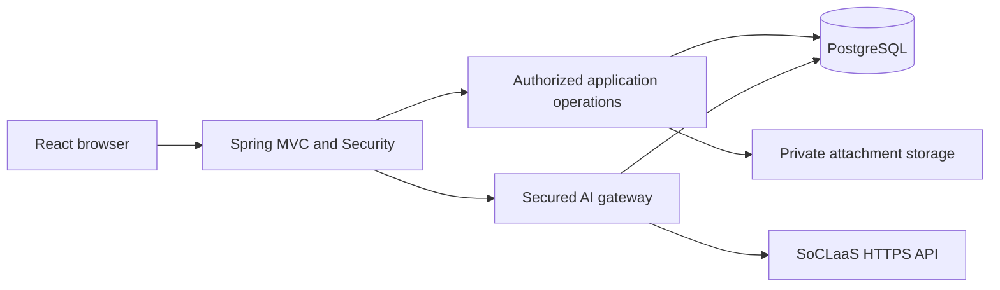
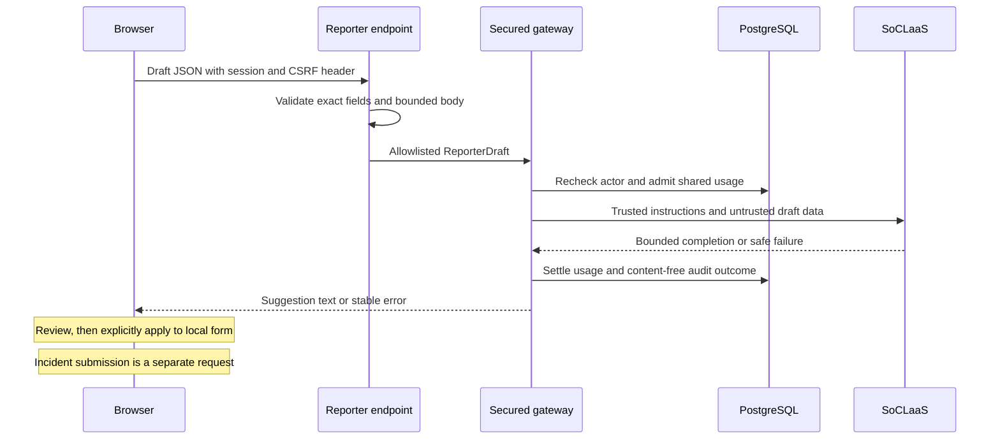

# Incident Desk Developer Guide

Incident Desk MP3 is a React web application served by a Spring Boot backend.
The backend authenticates users, authorizes incident operations, persists shared
state in PostgreSQL, and calls SoCLaaS through a secured advisory gateway.
The retained JavaFX application is a legacy MP2 entry point, not the web client.

- [Development setup](#development-setup)
- [Architecture and source map](#architecture-and-source-map)
- [Persistence, authorization and privacy](#persistence-authorization-and-privacy)
- [Incident operations and statistics](#incident-operations-and-statistics)
- [Web security](#web-security)
- [Advisory AI integration](#advisory-ai-integration)
- [Verification](#verification)
- [Deployment and operation](#deployment-and-operation)
- [Troubleshooting](#troubleshooting)
- [Specification-driven and multi-agent workflow](#specification-driven-and-multi-agent-workflow)
- [MP2 reuse and acknowledgements](#mp2-reuse-and-acknowledgements)

## Development setup

Use JDK 25, Node.js 24.16.0 and the checked-in Gradle Wrapper. Install Docker
only if using a local PostgreSQL container or building the deployment image.
From the repository root:

```powershell
Copy-Item .env.example .env.local
```

Run the copy command only when `.env.local` does not already exist. Preserve
existing private configuration rather than replacing it with empty placeholders.

Edit the private `.env.local` before starting. Set `DATABASE_URL` to a dedicated
development PostgreSQL database. For Neon, use the pooled application URL.
Supply the storage variables when testing attachment reads. `bootRun` loads
`.env.local`; existing process environment variables take precedence. A packaged
JAR reads process environment variables and does not load this file itself.
For local HTTP only, set `INCIDENT_DESK_SECURE_COOKIES=false`. Production must
retain secure cookies and HTTPS. Keep real connection strings and credentials
out of source control, screenshots, issues and shell transcripts.

After editing the environment file, start the backend:

```powershell
.\gradlew.bat bootRun
```

Start the frontend in a separate terminal:

```powershell
cd frontend
npm ci
npm run dev
```

Open <http://localhost:5173/>. Vite proxies API and health requests to the backend
on port 8080. A normal Gradle build embeds the frontend production assets in
`build/libs/incident-desk-web.jar`, which serves the web application at `/`.
`PORT` overrides the backend's default port.

### Environment configuration

| Variables | Purpose |
| --- | --- |
| `DATABASE_URL` | Application PostgreSQL connection; use a development database locally and the pooled Neon endpoint in production |
| `DATABASE_URL_UNPOOLED` | Direct connection used by the isolated database-test setup; not a replacement for `DATABASE_URL` |
| `AWS_ACCESS_KEY_ID`, `AWS_SECRET_ACCESS_KEY`, `AWS_ENDPOINT_URL_S3`, `AWS_REGION` | Private S3-compatible attachment storage |
| `INCIDENT_DESK_ATTACHMENT_BUCKET` | Storage bucket, default `incident-attachments` |
| `INCIDENT_DESK_NEON_REQUIRED` | Fail startup when the required production database/storage configuration is missing |
| `INCIDENT_DESK_SECURE_COOKIES` | Keep `true` for HTTPS; use `false` only for local HTTP |
| `INCIDENT_DESK_BOOTSTRAP_ADMIN_LOGIN`, `INCIDENT_DESK_BOOTSTRAP_ADMIN_PASSWORD` | One-time first-Administrator provisioning; remove both after successful bootstrap |
| `AI_ENABLED`, `SOCLAAS_API_KEY`, `SOCLAAS_MODEL` | Enable and configure backend-only AI access; AI defaults to disabled |
| `AI_CONFIGURATION_REVISION`, `AI_*` limits | Shared configuration fencing and downward-only resource controls; see `.env.example` |

The backend's database-dependent services require a configured data source.
Opening the frontend or receiving a health response without that configuration
does not establish a working registration or incident workflow. For attachments,
configure private storage as well as the database; metadata alone does not
provide object bytes. Never put secrets in `VITE_*` variables, which are bundled
into browser assets.

Public registration creates Reporters. To create the first Administrator, follow
[Administrator bootstrap](AdministratorBootstrap.md). Both bootstrap variables
must be removed after the first successful startup; replay is rejected. Do not
remove database markers to recover a privileged account. Ordinary responder
access is granted through the promotion and administrator category workflows.

## Architecture and source map



| Location | Responsibility |
| --- | --- |
| `frontend/src` | Role portals, local form state, API requests and escaped AI output |
| `web/security` | Registration, authentication, shared sessions, CSRF, password changes and bootstrap |
| `web/reporter`, `web/responder`, `web/admin` | Role-specific HTTP contracts, services and JDBC projections |
| `domain`, `application` | Reusable incident rules, lifecycle and application operations |
| `infrastructure/neon` | PostgreSQL configuration, private S3-compatible storage and smoke checks |
| `infrastructure/soclaas` | Provider adapter, trusted data selection, admission, budgets and circuits |
| `src/main/resources/db/migration` | Versioned PostgreSQL schema |
| `ui`, `startup`, `persistence` | Retained desktop entry points and supporting MP2 code |

The web surface includes Reporter incident submission and tracking, promotion
requests, Responder incident handling, and Administrator incident, account,
category, SLO and statistics workflows. Audit records are internal persistence
and security evidence; there is no user-facing audit viewer. Follow the current controllers and
[User Guide](UserGuide.md) for the exposed operations; legacy desktop methods do
not automatically imply a corresponding web endpoint.

### Implemented HTTP contracts

| Controller | Contract examples |
| --- | --- |
| `ReporterIncidentController` | `/api/v1/reporter/incidents` for owned incident operations |
| `SessionController`, `ReporterAccountRegistrationController` | GET `/api/v1/auth/session`; POST `/api/v1/auth/reporter/register` |
| `WebSecurityConfiguration`, `OwnPasswordController` | POST `/api/v1/auth/{reporter,responder,administrator}/login`, `/api/v1/auth/logout`, `/api/v1/auth/password` |
| `PromotionRequestController` | GET/POST `/api/v1/reporter/promotion-request`; GET `/api/v1/admin/promotion-requests`; POST `/{requestId}/decision` under the administrator path |
| `ResponderIncidentController` | POST queue `/query`, GET detail, POST `/{incidentId}/claim` and `/{incidentId}/resolve` under `/api/v1/responder/incidents` |
| `ResponderAiIncidentController` | POST `/api/v1/responder/incidents/{incidentId}/ai/advice` for advisory incident summary and investigation steps |
| `AdministratorIncidentController` | GET detail; POST comments, assignment, unassign and resolve under `/api/v1/admin/incidents/{incidentId}` |
| `AdministratorDashboardController` | `/api/v1/admin/dashboard` projections |
| `AdministratorAccountController` | `/api/v1/admin/accounts` account administration |
| `AdministratorSloController` | `/api/v1/admin/slo` SLO configuration |
| `AdministratorStatisticsController` | GET `/api/v1/admin/statistics`, with category, responder, reporter and period filters |
| `ReporterAiDescriptionController` | POST `/api/v1/reporter/ai/description` advisory draft improvement |

Administrator comments accept a request ID and text. Assignment and unassignment
carry an expected incident version; resolution carries the version, request ID
and remarks. These are concurrency/idempotency inputs, not authorization grants.
The backend validates the authenticated actor and current incident state before
committing. Responder resolution similarly carries a request ID and remarks.
Use the controller request records and HTTP tests for complete payload schemas.

Java package paths in this section are relative to
`src/main/java/com/company/incidentdesk/`. Authentication login requests are
form-encoded; feature mutation bodies use their controller's JSON contract.
Do not infer endpoint behavior from retained desktop service methods.

## Persistence, authorization and privacy

Spring Session stores web sessions in PostgreSQL. Security derives the actor
from the authenticated request, not browser-supplied account or role fields.
Ownership and category checks apply on the backend. Anonymous incident views
exclude reporter identity from normal Responder and Administrator projections.
Attachment reads are authorized and streamed through the backend rather than
exposing storage credentials or public object links.

Mutations and their success audit records share transaction boundaries.
Concurrent incident claims must select at most one assignee; denied or failed
operations must not leave a success audit or partial mutation. SLO calculations
use persisted UTC lifecycle timestamps. Consult `.agents/incident-lifecycle.md`,
`.agents/authorization-matrix.md`, `.agents/anonymity-policy.md` and
`.agents/slo.md` before changing these rules.

Flyway applies the checked-in migrations. V1 establishes identity and sessions;
V2 adds administrator data; V3 adds Reporter incidents; V4 adds promotions;
V5 adds AI usage controls; V6 adds AI circuits and audit; V7 adds resolution
history; V8 adds attachment metadata; V9 adds statistics cycle snapshots; V10
adds administrator incident comment requests. Preserve applied migrations and
add a forward migration for subsequent changes. Earlier experimental AI branches
used different version numbers: never repair a shared database blindly to fit
an old branch.

### Main persisted records

| Tables | Purpose |
| --- | --- |
| `accounts`, `account_credentials` | Identity, roles/account state and password hashes |
| `SPRING_SESSION`, `SPRING_SESSION_ATTRIBUTES` | Shared web sessions |
| `incidents`, `incident_resolutions`, `incident_comments` | Incident lifecycle, resolution history and comments |
| `incident_attachments` | Metadata for privately stored objects |
| `responder_promotion_requests` and requested/approved category tables | Promotion review and category choices |
| `responder_category_access` | Active responder grants |
| `slo_target_versions` | Persisted SLO configuration versions |
| `audit_events`, `application_settings` | Internal audit and durable application settings |
| `ai_usage_control`, `ai_usage_requests` | Shared gateway controls, reservations and request accounting |

## Incident operations and statistics

Reporter submission validates the title, category, description and anonymity,
then persists the incident and audit in one transaction. Its submission key
supports safe recognition of a repeated submission. Reporter list reads select
only the authenticated account's incidents. The web Reporter interface currently
exposes submission and list tracking rather than the desktop detail/edit flow.

Responder queue and detail reads apply current category grants. A claim uses a
conditional database update that rechecks incident state, absence of an assignee,
and the actor's authorization. Competing claims cannot both succeed. Resolution
uses a request ID, verifies the current assignment and role, records a numbered
resolution cycle, and writes its audit atomically. A repeated matching request
can return the recorded result instead of creating another cycle.

Administrator assignment, unassignment and resolution use current incident
state and version checks. Stale writes return a conflict instead of replacing
someone else's work. Comment creation has a separate request ID. These backend
checks remain necessary even when the UI disables an action. The concrete stores
are `web/responder/JdbcResponderIncidentGateway` and
`web/admin/JdbcAdministratorIncidentStore`.

SLO targets are versioned and apply prospectively. A target created after an
incident entered its queue does not retrospectively apply to that incident.
Operational statistics use persisted lifecycle and resolution-cycle snapshots,
not elapsed browser time. They distinguish the number of resolved incidents
from the number of completed cycles. A missing average means no eligible data,
not a duration of zero. Queue time to claim is not attributed to the eventual
resolver, so responder-filtered statistics do not provide that queue metric.
The UI treats selected dates as inclusive UTC dates and sends instant bounds to
`AdministratorStatisticsController`. See `JdbcAdministratorStatisticsStore` and
the V9 migration before changing historical metrics.

## Web security

Spring Security protects session-authenticated endpoints. Unsafe browser requests
send the current `XSRF-TOKEN` cookie value in `X-XSRF-TOKEN`. The frontend refreshes
a stale security session and retries once only for the designated security-session
error. It must not retry accepted AI generation after a provider failure.
Session cookies are HTTP-only, SameSite=Lax and secure by default; the session
timeout is 30 minutes. Credential hashing, validation and account-state checks
remain server responsibilities. Do not carry MP2 local-file authentication
assumptions into the web application.

`WebSecurityConfiguration` uses BCrypt with strength 12 for web credentials.
The retained desktop authentication implementation is a different entry point;
its hashing and session assumptions do not describe web authentication. Login
rotates the session identifier, rejects a portal/account-role mismatch, and
returns a generic failure. Public registration cannot select a privileged role.
Temporary credentials restrict the holder to password replacement and logout
before normal role operations become available.

Promotion approval changes role/category access and invalidates the affected
account's sessions. Password reset and account administration must preserve the
corresponding credential/session safeguards in their services. Anonymous identity
is excluded through explicit projections; it must not be reconstructed from
audit metadata, logs or whole-entity serialization for normal user responses.

## Advisory AI integration

The implemented Reporter endpoint is `POST /api/v1/reporter/ai/description`.
It accepts the draft title, category and description, checks the authenticated
Reporter, and returns a bounded description suggestion. Applying it changes only
the browser form; submitting the incident remains a separate operation.
The implemented Responder endpoint is
`POST /api/v1/responder/incidents/{incidentId}/ai/advice`. It returns advisory
text for one currently viewable incident; claim and resolution remain separate
operations.

### Reporter request and review flow



The JSON body contains exactly `title`, `category` and `description`, all strings.
Categories use `IT`, `HUMAN_RELATIONS` or `FACILITIES`. Unknown or duplicate fields,
trailing JSON, invalid structure and an over-limit body are rejected. Success
returns `{"description":"..."}` with `Cache-Control: no-store`. The endpoint
does not accept an account ID, arbitrary system prompt, model or provider URL.

### Responder incident advice

The Responder advice endpoint requires an authenticated, enabled Responder and a
CSRF-protected POST. The incident UUID is its only input: query parameters and
request bodies are rejected. An unassigned `SUBMITTED` incident requires current
category access; an `ASSIGNED` incident is eligible for its assignee, including
after category access is revoked. Missing or inaccessible incidents receive the
same privacy-safe unavailable response. The gateway selects authorized data
immediately before admission and checks access again before returning the result.

`JdbcResponderAiSelector` reads a consistent PostgreSQL snapshot. The provider
receives only the incident identifier, category label, title, description,
lifecycle state, creation time, current stage and elapsed seconds, and a
privacy-safe current-stage SLO state. The queue stage uses the current cycle's
queue-entry time; the in-progress stage uses its first assignment time. The
selector uses the SLO target effective at queue entry. Reporter identity,
comments, attachments, audit records, other incidents, and internal ownership
data are excluded. Invalid stage timestamps reject the request before provider
dispatch.

Success returns `{"advice":"..."}` with `Cache-Control: no-store`. The React
detail view presents the bounded result as escaped, labelled text in both
eligible states. It never writes the advice to incident data or pre-fills
resolution remarks. Navigation, cancellation, actor changes, and loss of detail
access discard late output in the browser. Cancellation does not guarantee that
provider work already accepted has stopped. An access change during generation
can prevent delivery of the result, but cannot retract data already sent in an
authorized provider request.

The route returns `UNAVAILABLE` with HTTP 404 for denied or missing incidents,
`AI_RATE_LIMITED` with 429 for admission limits, `AI_TIMEOUT` with 504,
`AI_INVALID_RESPONSE` or `AI_OUTPUT_TOO_LARGE` with 502, and `AI_UNAVAILABLE`
with 503 for provider or configuration failure. Invalid input returns
`AI_REJECTED` with 400 for a query string or nonempty body. The frontend shows a
safe generic failure message and allows an explicit retry; normal incident
handling remains available.

### Shared gateway and provider safeguards

`SecuredAiGateway` combines trusted actor checks, `AiDataSelector`,
`AiPromptBuilder`, shared PostgreSQL usage admission and the `SoclaasClient`.
The client uses Java HTTP and Jackson; Spring AI is not required. No browser
receives the provider key. The fixed allowed origin is
`https://soclaas-api.comp.nus.edu.sg/v1`; model and budget metadata must be
verified before accepting generation. Provider access may require the NUS network
or VPN, including during development.

AI is disabled by default. To enable it, configure `AI_ENABLED`,
`SOCLAAS_API_KEY`, `SOCLAAS_MODEL` and the settings in `.env.example` through a
private runtime environment. `AI_CONFIGURATION_REVISION` fences older instances
after configuration repair. Never enable it merely to make a health check pass.
Provider failure leaves normal non-AI incident reporting available.

Default account limits are 5 requests/minute, 30/hour and 100/day. Shared
admission also limits concurrency and reserves budget against verified provider
ceilings. Default bounds include a 3-second connection timeout, 30-second request
deadline, 16-KiB input and output byte limits, 8,000 input tokens and 1,200 output
tokens. Conservative input estimation can reject a draft below its byte limit.
The adapter caps provider response bodies at 64 KiB and never automatically
retries generation. Browser cancellation does not guarantee provider work or
billing stopped.

`AiUsageLedger` stores admission and reservations in PostgreSQL so limits apply
across application instances. Reserve resources before dispatch; do not replace
this with a browser counter or process-local map. Unknown provider usage must
remain conservatively accounted for rather than being treated as free.
`AiGatewayControl` persists shared circuit and configuration state. Configuration
repair and metadata refresh must respect that state rather than bypassing a
failed provider check. See the specification for exact lease, freshness,
settlement and circuit-transition rules.

Incident text is untrusted data, separated from trusted instructions. The model
has no database access, application credentials, mutation tools or callback path.
Blank, malformed, oversized, refused or tool/function-call results are rejected;
valid output is displayed as escaped text for human review. These controls do
not constitute a universal prompt-injection detector. Safe errors and content-free
audit outcomes must not contain prompts, generated text, keys, cookies or raw
provider bodies. See [AI specification](../workflow/ai-features.md) for exact
admission, accounting, circuit and failure contracts.

| HTTP status | Reporter AI error code | Meaning |
| --- | --- | --- |
| 400 | `AI_REJECTED` | Invalid draft request body |
| 403 | `AI_REJECTED` | Request rejected by the AI path; CSRF errors are handled separately |
| 429 | `AI_RATE_LIMITED` | Account/global rate or budget admission limit |
| 502 | `AI_INVALID_RESPONSE` or `AI_OUTPUT_TOO_LARGE` | Provider output could not safely be used |
| 503 | `AI_UNAVAILABLE` | AI disabled, missing gateway or unavailable provider/control state |
| 504 | `AI_TIMEOUT` | Provider deadline exceeded |

Authentication and authorization can reject the request before this controller
runs. The frontend maps known error codes to safe messages and keeps the draft.
It must not display raw provider bodies or exception strings.

### Security controls and their limits

| Boundary | Implemented protection | Remaining limitation |
| --- | --- | --- |
| Draft to provider | Three-field allowlist, authorization, separate instructions/data, bounded request | User-supplied text can still influence wording |
| Provider to browser | Strict completion validation, escaped text, no tools or output interpreter | Advice can be misleading even when structurally valid |
| Suggestion to saved incident | Explicit local apply and a separate authorized submission | A person can accept an inaccurate suggestion |
| Shared provider quota | Database admission, reservations, deadlines and shared circuits | Provider ceilings and connectivity can change |
| Diagnostics | Safe error categories and content-free audits | Infrastructure access and provider retention need separate operational review |

An off-topic or injection-like draft is not proof that a universal detector
exists. Verify the selected outbound data, absent mutation authority, escaped
rendering and unchanged incident state in adversarial tests. A plausible-looking
answer alone is not security evidence.

## Verification

Run the full local verification path:

```powershell
.\gradlew.bat build
```

This includes frontend type-checking, lint, component tests and bundling, Java
checks, and retained JavaFX packaging verification. On headless Linux use
`xvfb-run --auto-servernum ./gradlew build`. Targeted frontend checks are
`npm run check` from `frontend/`. Target provider tests without a real key using:

```powershell
.\gradlew.bat test --tests 'com.company.incidentdesk.infrastructure.soclaas.*'
```

Database tests require an explicitly isolated test database. Copy
`.env.test.example` to `.env.test.local`, provide a direct test-only connection,
and confirm isolation before running `registrationDatabaseTest`. The task
rejects pooled Neon endpoints and protected application database targets, creates
a random schema, applies migrations, and drops that schema afterwards.
`neonTestServiceSmoke` checks the separate test database and private storage with
a synthetic object round trip. Never point these tasks at production data.

The corresponding commands are:

```powershell
.\gradlew.bat registrationDatabaseTest
.\gradlew.bat neonTestServiceSmoke
```

Configure the private test environment first. For non-Neon PostgreSQL, the
database-test task accepts `INCIDENT_DESK_TEST_DATABASE_URL`; the isolation
acknowledgement is `INCIDENT_DESK_TEST_DATABASE_CONFIRM_ISOLATED=true`.
A normal test invocation can skip database or opt-in provider cases when their
required environment is absent. Inspect test reports instead of treating a green
build as proof those cases ran. Live SoCLaaS tests are opt-in and consume quota;
use deterministic fake-provider coverage for routine development.

`registrationDatabaseTest` selects specific web database test classes; it does
not include the AI ledger, control or gateway PostgreSQL suites. Run those through
the regular `test` task with the isolated-test variables supplied in its process
environment, using the SoCLaaS package filter above if desired. Do not assume the
regular task loads `.env.test.local` in the same way as the dedicated database
task.

### Focused test coverage

| Area | Representative tests |
| --- | --- |
| Provider validation and bounded responses | `SoclaasClientTest`, `SoclaasSettingsTest`, `SoclaasBudgetClientTest` |
| Shared AI admission and concurrency | `AiUsageLedgerPostgresTest`, `AiGatewayConcurrencyPostgresTest` |
| Circuits, accounting and authorization | `AiGatewayControlPostgresTest`, `SecuredAiGatewayPostgresTest` |
| Reporter AI HTTP/session/CSRF integration | `ReporterAiDescriptionControllerTest`, `ReporterAiHttpPostgresTest` |
| Responder AI authorization, data selection and HTTP integration | `ResponderAiIncidentControllerTest`, `JdbcResponderAiSelectorPostgresTest`, `ResponderAiHttpPostgresTest` |
| Responder claim and resolution | `ResponderIncidentPostgresTest` |
| Promotion and session effects | `PromotionWorkflowPostgresTest` |
| Administrator mutations and authorization | `AdministratorIncidentPostgresTest`, `AdministratorIncidentSecurityTest` |
| Historical statistics and upgrades | `AdministratorStatisticsPostgresTest`, `AdministratorStatisticsMigrationUpgradePostgresTest` |
| Frontend draft/review state | `frontend/src/reporter/ReporterAiDescription.test.tsx` |
| Frontend responder advice state | `frontend/src/responder/ResponderPortal.test.tsx`, `frontend/src/responder/ResponderSessionChange.test.tsx` |

Java tests reside under `src/test/java/com/company/incidentdesk/`. These names
identify existing coverage; they do not claim every case ran during this update.

Build and smoke-test the packaged web artifact separately:

```powershell
.\gradlew.bat bootJar
java -jar build\libs\incident-desk-web.jar
```

With its environment configured, check <http://localhost:8080/health> and open
<http://localhost:8080/>. The health endpoint deliberately hides component details;
`UP` does not prove every role journey or external AI call works. Record the exact
commit, commands, failures, skipped tests and manual coverage.

### Documentation verification snapshot

On 23 October 2026, the guides and screenshots were checked against commit
`aea4f4d5beaee2b6dc5025e737d3dd2a254d4a3e`. `bootJar` passed, including Java
compilation and the TypeScript/Vite production build. The packaged application
started against a fresh local PostgreSQL 18 database and validated all ten
migrations. Browser checks exercised Reporter registration, sign-in, submission
and promotion request; Administrator promotion approval, comment creation and
SLO saving; and Responder claim and resolution. The screenshots use fictional
data from that instance. AI was disabled, so this session did not verify a live
provider response. The full test suite, public deployment and destructive account
actions were not verified as part of this documentation update.

## Deployment and operation

The Docker build packages React and Spring Boot into one Cloud Run service.
PostgreSQL and private attachment storage remain external. Follow the
[Cloud Run runbook](CloudRunDeployment.md) for Artifact Registry, GitHub OIDC,
Workload Identity Federation and separate deployment/runtime service accounts.
The routine deployment workflow allows `main` through the protected `production`
environment; manual runs from other branches perform verification only.
Google service-account key files are not required.

The [Dockerfile](../Dockerfile) has separate Node frontend and JDK backend build
stages, followed by a JRE runtime running as UID 10001. It packages the compiled
web artifact, not database records or a developer's private environment files.
Runtime secrets and provider connectivity remain deployment configuration.
Changing a local `.env.local` does not automatically update another developer's
environment or the deployed Cloud Run service.

Production requires the Neon configuration and `INCIDENT_DESK_NEON_REQUIRED=true`.
Keep development, test and production data separate. Review secret references,
bootstrap removal, provider connectivity, database migration compatibility,
monitoring and rollback readiness before deployment. A health response alone is
not release approval. `/health` exposes aggregate status; retain content-free
operational logs and inspect hosted CI for the exact release commit.

Feature PRs target `main`. `master` is reserved for the assignment submission
snapshot and must only be replaced on explicit human submission approval after
verification. Do not infer that a successful local build authorizes deployment
or final submission.

## Troubleshooting

| Symptom | Inspect |
| --- | --- |
| Frontend loads but registration or incident operations fail | Backend `/health`, configured data source, migrations, and the actual API response |
| Local HTTP login does not retain its session | `INCIDENT_DESK_SECURE_COOKIES=false` locally; retain `true` in HTTPS production |
| Vite requests reach the wrong backend | `frontend/vite.config.ts` proxy targets port 8080; `PORT` changes require a matching development proxy |
| Restart fails after bootstrap | Remove both bootstrap variables; preserve the durable marker and existing Administrator |
| Flyway reports a version/checksum conflict | Identify the database and branch history; use a fresh isolated database for an old experimental branch rather than repairing shared history blindly |
| AI fails while normal incidents work | AI enablement, selected model, NUS network/VPN access, metadata freshness, shared circuits and quota |
| Tests pass with database cases skipped | Private isolated-test settings, isolation acknowledgement and the XML test reports |
| Documentation site still shows MP2 branding | `docs/_config.yml` retains MP2 URL/base-path metadata; website migration is separate from these guide edits |

Use content-free diagnostics. Never paste passwords, API keys, connection URLs,
session cookies, provider bodies or real incident text into issue evidence.

## Specification-driven and multi-agent workflow

`AGENTS.md` identifies the canonical specifications. Locate observable acceptance
criteria before implementation, trace the change and its tests to those criteria,
and record evidence before ticking a requirement. Agent-generated text cannot
establish human approval. Separate analyst, architecture/security, implementation,
test and review roles exchange bounded handoffs with scope, files, risks, checks
and unresolved decisions. Their proposed roles and outstanding human gates are
recorded in the workflow artifacts, not assumed complete by this guide.

For a gateway change, the specification handoff identifies the allowed draft
fields, quota/failure rules and excluded actions. The implementation handoff names
the changed gateway/controller files and unresolved provider assumptions. The test
handoff supplies captured synthetic provider payloads, database concurrency results
and denied-path evidence. The reviewer checks those artifacts against the approved
contract rather than accepting the implementer's summary as proof.

Keep security design and approval with the responsible owner. A bounded agent can
inspect a file, update documentation or add an agreed test fixture; it must not
silently expand provider data selection, relax authorization or invent approval.
When evidence contradicts a handoff, record the disagreement and resolve it against
the governing specification and source. Outstanding human ownership and review gates
remain visible in `workflow/agent-workflow.md` and the relevant ADRs.

| Workflow artifact | Purpose |
| --- | --- |
| `README.md` | Workflow rules, approval gates and evidence conventions |
| `acceptance-criteria.md` | Index into feature-specific observable criteria |
| `product-requirements.md` | Product requirements and scope context |
| `architecture.md` | Architecture direction and unresolved design sections |
| `threat-model.md` | Assets, trust boundaries, threats and mitigations |
| `agent-workflow.md` | Agent roles, handoffs, isolation and disagreement handling |
| `reporter-vertical-slice.md` | Reporter contracts and acceptance criteria |
| `responder-vertical-slice.md` | Responder contracts and acceptance criteria |
| `administrator-vertical-slice.md` | Administrator contracts and acceptance criteria |
| `promotion-journey.md` | Promotion decisions, category access and session effects |
| `ai-features.md` | Provider contract, advisory features and resource safeguards |
| `neon-services.md` | Database and private object-storage configuration |
| `cloud-run-deployment.md` | Deployment contracts and verification gates |
| `interaction-summaries.md` | Index of development interaction summaries |
| `decisions/` | Numbered ADRs and their individual approval status |
| `plans/` | Issue-scoped implementation plans |
| `reviews/` | Review findings and decisions |
| `test-evidence/` | Dated commands, outcomes, limitations and acceptance evidence |

Paths in the table are relative to `workflow/`. Consult each artifact's current
status: several retain pending reviews or manual gates. Detailed development
interaction summaries also live under `logs/`; they are not runtime application
logs. Do not publish secrets or user data as workflow evidence.

## MP2 reuse and acknowledgements

This repository continues the team's
[MP2 Incident Desk](https://github.com/CS3227-2610-MP2-IncidentAssistant/CS3227-2610-MP2).
It retains the Java
package structure, domain concepts, lifecycle and SLO rules, existing application
services, tests and the JavaFX entry point. MP3 adds a React interface, HTTP
contracts, shared PostgreSQL persistence and sessions, private object-storage
integration, web authorization and the advisory SoCLaaS gateway. Reuse is selective:
legacy local storage and desktop UI do not define production web behavior.

The following measurement compares the MP2 baseline `2d936043d15028efd41d0609b81649977b6c5848`
(the parent of the first MP3 requirements commit) with MP3 snapshot
`aea4f4d5beaee2b6dc5025e737d3dd2a254d4a3e`:

| Source measurement | Result |
| --- | --- |
| MP2 Java production source files | 278 |
| MP3 Java and frontend production source files | 373 |
| Files unchanged at the same path, by Git blob identity | 271 (72.7% of MP3 files) |
| Bytes in those unchanged files | 672,438 of 1,410,226 bytes (47.7%) |

Scope: `.java` files under `src/main/java/` and `.ts`, `.tsx` and `.css` files
under `frontend/src/`, excluding frontend test files and its test directory.
Use `git ls-tree -r -l <commit>` to obtain each path, blob ID and byte size;
match paths and identical blob IDs between the two snapshots. Percentages divide
unchanged file counts or bytes by the corresponding MP3 total. Tests, resources,
dependencies, generated output and documentation are excluded. This measures
exactly retained source, including legacy desktop code; it is not a percentage
of the deployed web execution path. Modified files can also reuse MP2 logic,
which this conservative measurement does not count as unchanged.

The implementation depends on Spring Boot/Security/Session, PostgreSQL, Flyway,
Jackson, AWS SDK, React, Vite, TypeScript, Vitest, Testing Library, JUnit, JavaFX,
Gradle and Shadow, as declared in [build.gradle](../build.gradle) and
[frontend/package.json](../frontend/package.json). Neon provides external
database/storage integration; Google Cloud Run hosts the container; SoCLaaS supplies
LLM access. Course AI-security and SDD guidance informs the workflow and safeguards.
The team's canonical requirements and policies are under [`.agents/`](../.agents/),
and development interaction summaries are retained under [`logs/`](../logs/).
Record any additional reused code, assets or external ideas with their actual
source and licence when introducing them. Retained MP2 website assets and links
must not be represented as screenshots of the MP3 web client.
