# Incident Desk User Guide

Incident Desk is a web application for reporting workplace incidents, assigning responders, and monitoring service objectives. There are three portals: Reporter, Responder, and Administrator.

## Contents

- [Open the application and sign in](#open-the-application-and-sign-in)
- [Report and track an incident](#report-and-track-an-incident)
- [Use description assistance](#use-description-assistance)
- [Request responder access](#request-responder-access)
- [Handle incidents as a responder](#handle-incidents-as-a-responder)
- [Administer incidents and accounts](#administer-incidents-and-accounts)
- [Configure SLOs and review statistics](#configure-slos-and-review-statistics)
- [Troubleshooting and current limits](#troubleshooting-and-current-limits)

Screenshots captured on 23 October 2026 show a local demonstration with fictional accounts and incidents. Each image focuses on the relevant form, list, or result. They illustrate the interface, not evidence of a public deployment. Your data and available categories may differ.

## Open the application and sign in

1. Obtain the application URL from your deployment owner and open it in a browser. For local setup, see the [Developer Guide](DeveloperGuide.md).
2. At **Choose your portal**, select **Reporter**, **Responder**, or **Administrator**.
3. Enter your **Login name** and **Password**, then select **Sign in**. The account must be enabled and match the selected portal.
4. New users can select **Create Reporter account** from Reporter sign in, enter a login name, password, and confirmation, and select **Create account**. Registration creates a Reporter, not an administrator or responder.

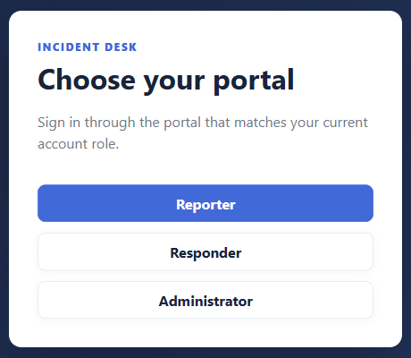

Use **Sign out** when finished, especially on a shared computer. Select **Update password** to change your password. If an administrator resets your password, obtain the temporary password through your agreed private channel and complete the required password change before continuing. The application asks for your current password, new password, and confirmation.

An administrator account is provisioned by the deployment owner. There are no shared default production credentials in this guide.

## Report and track an incident

1. Sign in as a Reporter and open **My incidents**.
2. In **What happened?**, enter a **Title** of up to 200 characters.
3. Choose **IT**, **Human Relations**, or **Facilities** under **Category**.
4. Enter a factual **Description**, up to 10,000 characters. For example: “The meeting room projector does not turn on. The power indicator remains off after checking the wall switch.”
5. Optionally select **Submit anonymously**.
6. Select **Submit incident** and check the result before submitting again.

Anonymous submission hides your identity in normal responder and administrator views. Hosting operators may still access protected records; information in your description can also identify you. It does not remove the report from your own account.

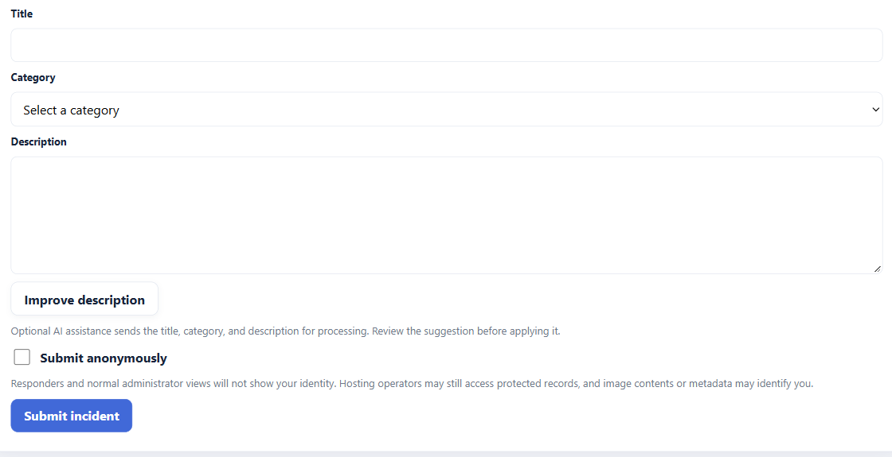

Your reports appear under **My incidents**. Use **Search your reports**, **Search**, **Refresh**, and the page controls to find them and check their status. Reporter results are an owned-incident list; this page does not provide a detail link or editing, reopening, or withdrawal controls.

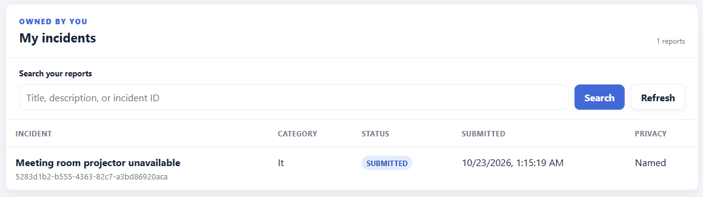

## Use description assistance

Description assistance is optional. You can submit a report without using AI.

1. Fill in the title, category, and description first. The **Improve description** button requires all three.
2. Select **Improve description**. This sends those fields to the configured AI service for processing. Avoid unnecessary personal or confidential information.
3. Read the **AI-generated suggestion** and check that it preserves the facts. The model can make mistakes or omit details.
4. Select **Apply suggestion** to replace the description in the form, or **Discard** to keep your original draft.
5. Review the form and separately select **Submit incident** when ready.

Applying a suggestion does not submit an incident. **Cancel** stops waiting for an answer; processing already accepted by the provider may still consume quota. Editing the draft invalidates an older suggestion. AI output is displayed as text and does not execute commands or perform incident actions.

If assistance is disabled, unavailable, rate limited, or returns an invalid suggestion, read the displayed message. Your draft remains available for manual editing and submission. Wait before retrying a quota error. Large requests can be rejected even within the visible character limits because the combined encoded request has a separate size limit.

## Request responder access

1. In the Reporter sidebar, select **Promotion**.
2. Choose the categories you want to handle and optionally enter **Additional comments** explaining your request.
3. Submit the request and check the request history. Use **Refresh** to obtain the latest decision.
4. An administrator reviews the request. Approval changes your account to a Responder with the approved categories. Sign in again through the **Responder** portal after approval.

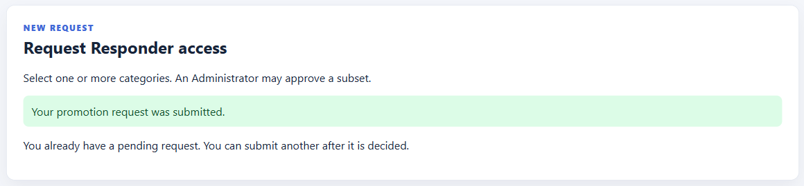

A pending request must be decided before another can be submitted. Approval may grant only selected requested categories; it does not grant administrator access.

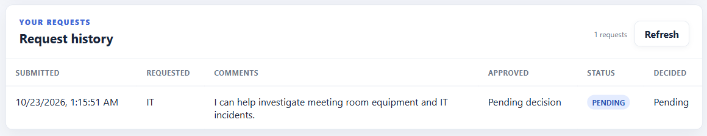

## Handle incidents as a responder

Sign in through **Responder** using an account with approved categories. The **Incident queue** shows incidents within your authorized category scope.

1. Use **Search incidents**, category and status choices, and **Assignment** to narrow the queue.
2. Choose **All queue incidents**, **Assigned to me**, or **Available to claim**, then select **Apply filters**.
3. Use **Refresh queue** and the page controls to update or browse results.
4. Select an incident title to open its details.

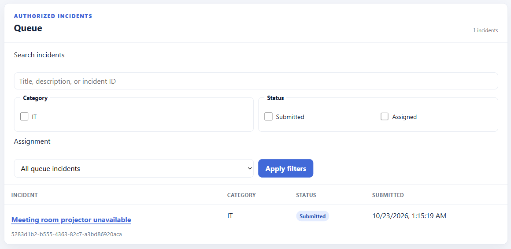

For an available incident, select **Claim incident** in its detail view. A successful claim assigns the incident to you and changes its status to **ASSIGNED**. If someone else claims it first, refresh the status rather than assuming your claim succeeded.

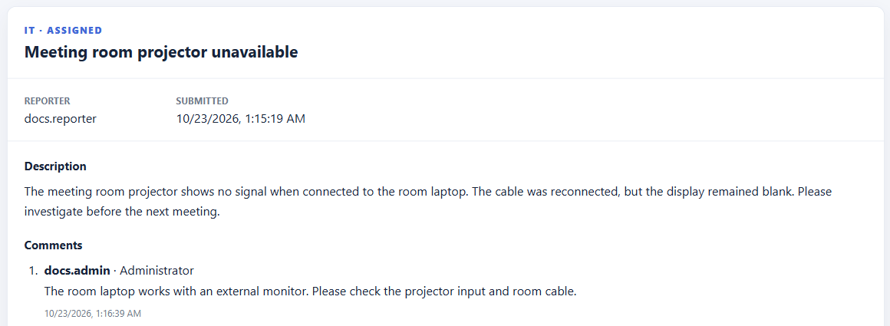

For an incident assigned to you, inspect its description and available history, enter **Resolution remarks** of up to 2,000 characters, and select **Resolve incident**. Check the confirmation before returning to the queue. Resolution remarks must explain the outcome; resolving an incident is separate from viewing it.

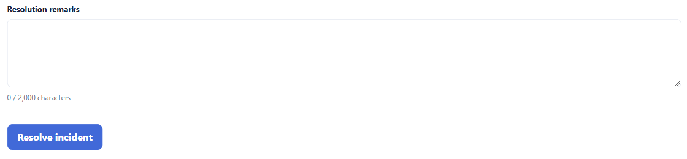

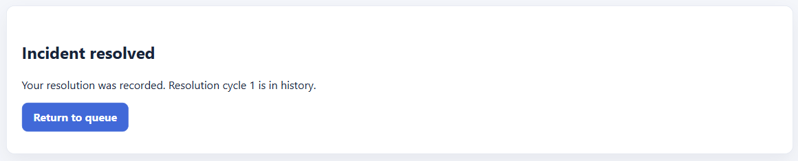

If the result of a claim or resolution is uncertain because the connection failed, use the displayed status-check or safe-retry control before attempting another action. **Back to queue** returns to the list. Access can change when an administrator changes your category grants.

## Administer incidents and accounts

### Dashboard and incident details

Sign in through **Administrator** and select **Dashboard**. The company overview shows incidents across categories and current category targets. Use **Search incidents**, **Search**, **Reset**, **Refresh**, and page controls to locate a report. Select its title to inspect the detailed record.

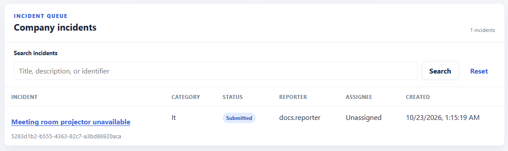

Details can include description, assignment, lifecycle, resolution history, SLO information, and any existing comments or attachments. Anonymous reporters remain masked in the normal view. Administrators can also perform the following actions when the incident state permits them:

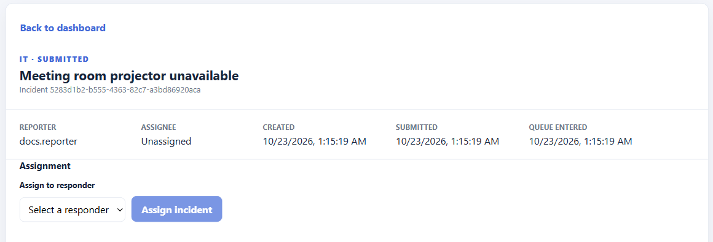

- Select an eligible responder under **Assign to responder** or **Reassign to responder**, then select **Assign incident** or **Reassign incident**.
- Select **Unassign incident** and confirm the dialog to remove an assignment.
- Enter text under **Add a comment** (up to 4,000 characters) and select **Add comment**.
- Enter **Resolution remarks** (up to 2,000 characters) and select **Resolve incident** to record an administrator resolution.

If another session changes the incident, the latest details are reloaded. Review them before retrying. Attachment display does not provide an upload control.

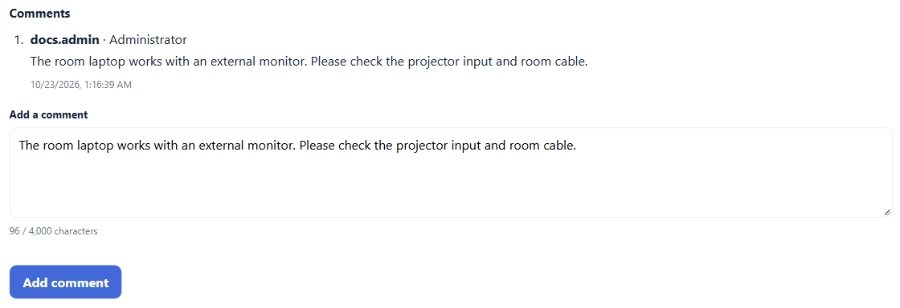

### Accounts and promotion requests

Select **Accounts** to view active accounts and pending promotion requests.

- **Configure categories** on a Responder changes the categories that account can handle. Review the selection before saving.
- **Reset password** asks for confirmation and reveals a temporary password. Share it privately with the account owner; the owner must change it before normal use.
- **Delete** opens a confirmation. **Delete account** disables the login while retaining historical incident references. This action cannot be undone from the interface.

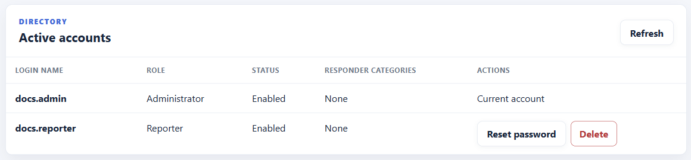

For a promotion request, review the requested categories and comments, select **Categories to grant**, and choose **Approve selected categories**. Review **Confirm promotion** before confirming. Alternatively select **Reject** and confirm the rejection. Cancel the confirmation to leave the request pending.

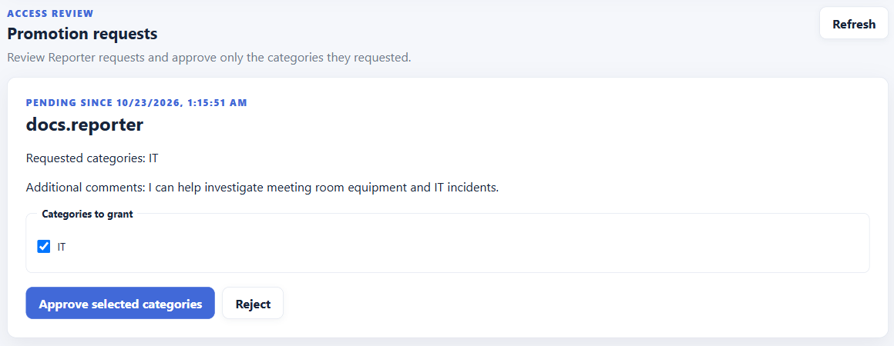

## Configure SLOs and review statistics

SLOs are service level objectives used to assess response and resolution performance.

### Configure category targets

1. Open **SLO configuration** and choose the category.
2. Review its current effective target and version history.
3. Enter **Average time to claim (minutes)**, **Average time in progress (minutes)**, and **Average reopen rate (%)**.
4. Select **Save new version**. A successful change creates a new version rather than rewriting the earlier history.

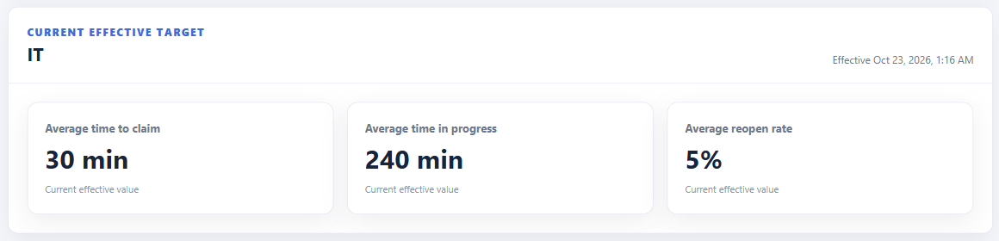

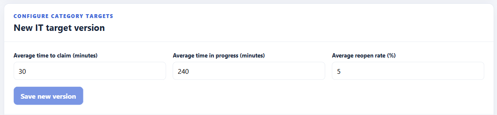

If another session changed the targets, refresh and review the latest values before trying again. A category without configured targets is shown as not configured.

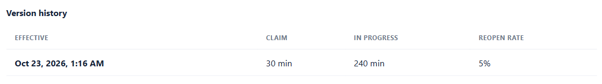

### Review statistics

Open **Statistics**. Choose categories, a responder, a reporter, and dates as needed, then select **Apply filters**. **Reset** removes your filters; **Refresh** reloads the current selection.

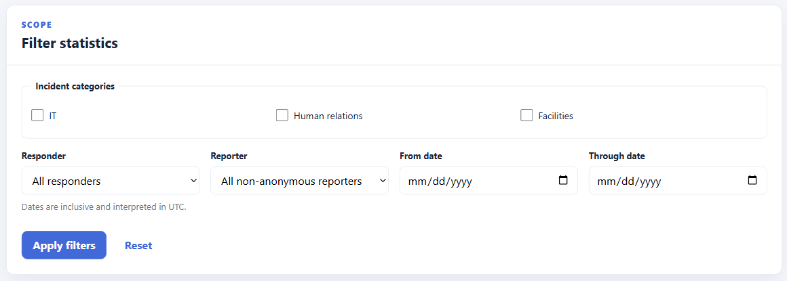

The page reports incident outcomes and responder resolution performance, including resolved counts, average time to claim, average time in progress, reopened incidents, and administrator-resolved incidents. An unavailable average is not a zero-duration response. Historical statistics may include activity created outside the currently exposed web actions.

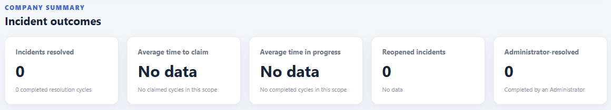

## Troubleshooting and current limits

| Situation | What to do |
| --- | --- |
| Sign in fails | Check your credentials, selected portal, and whether the account is enabled. Contact an administrator for a password reset if needed. |
| Session expires or access changes | Sign in again through the correct portal. Do not assume a pending action succeeded. |
| A list is empty | Check filters, page selection, and your role or category access, then refresh. |
| Service or network error | Keep a copy of an important draft, restore connectivity, and use the displayed retry or status-check control. |
| Improve description is disabled | Enter a nonblank title and description and choose a category first. |
| AI request fails | Continue manually or retry later as the message advises. AI availability is separate from normal incident submission. |
| Another user changed the same item | Refresh and review its latest state before acting again. |

The web application stores shared records on its server database. A browser refresh can lose an unsubmitted form; there is no saved-draft workflow. Do not use the old desktop application's local JSON files or JAR instructions for this web version.

The current web interface does not offer Reporter incident editing/reopening, attachment upload, Reporter or Responder comment creation, responder handoff, or an audit-log browser. AI assistance is currently exposed for Reporter descriptions only. This guide describes available controls rather than planned desktop-feature parity.
