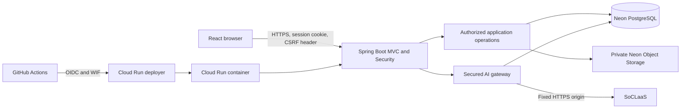

# MP3 Architecture

Status: **The production web baseline is implemented and deployed. This record
describes the current architecture; feature-specific verification and the
independent/release gates named below remain open where their owning artifacts
say so.**

## Context and deployment shape

Incident Desk is a React single-page application packaged into the Spring Boot
web artifact and container. The browser never talks directly to PostgreSQL,
private object storage, or SoCLaaS.

The deployed topology is one Cloud Run service in Singapore, one managed Neon
PostgreSQL production branch, one private branch-scoped attachment bucket, and
SoCLaaS as the external LLM provider. GitHub Pages publishes the product site.
Development uses the Vite proxy and local/test-only configuration; tests use
isolated schemas and fake providers. Codex or Claude hosting is not part of the
production topology.

The detailed source and component map is maintained in
[`../docs/DeveloperGuide.md`](../docs/DeveloperGuide.md#architecture-and-source-map),
and the rendered diagrams live under `../docs/diagrams/`.

## Request, authentication, and session flow

The public React entry page selects a Reporter, Responder, or Administrator
portal. The choice is an expected-role constraint, not proof of role. All
portals authenticate against the same PostgreSQL account and credential store.
Only the Reporter portal exposes registration, and the backend always creates a
Reporter regardless of extra browser fields. The first Administrator is
created by the one-time bootstrap in
[`../docs/AdministratorBootstrap.md`](../docs/AdministratorBootstrap.md);
Responder access comes from the approved promotion journey.

Spring Security authenticates credentials and stores the security context in
Spring Session JDBC. Authentication rotates the session identifier. React
loads trusted session state from the backend and reads the current SPA CSRF
cookie immediately before each unsafe request, sending it in the supported
header. A stale-token response may trigger at most one bounded recovery as
defined by [ADR-002](decisions/ADR-002-spa-csrf-token-flow.md). Production
cookies are Secure, HttpOnly, host-only, SameSite=Lax, and bounded; protected
responses are private/no-store. Logout and security-sensitive account changes
invalidate or fail closed existing sessions as specified by each workflow.

## Authorization boundary

React controls are usability only. Controllers provide coarse role routing and
bounded transport parsing, while application/domain operations enforce the
current account, role, ownership, category access, assignment, lifecycle, and
resource rules. Actors and timestamps come from the trusted request context and
application clock, never the request body. Every resource read or mutation
reauthorizes against current persisted state; operations with stale or
concurrent risk repeat the check inside their transaction. Privacy-minimized
role-specific DTOs prevent accidental entity serialization, and missing versus
forbidden resources use the same safe representation when distinction would
leak protected existence.

## PostgreSQL schema, migrations, and transactions

Production web state is stored in shared PostgreSQL. Forward-only Flyway
migrations under `../src/main/resources/db/migration/` create accounts,
credentials, JDBC sessions, incidents, promotion requests, comments,
attachment metadata, resolution cycles, SLO versions, AI admission/accounting,
and append-only audit records. Applied migrations are not edited.

JDBC adapters implement role-specific ports without leaking SQL into domain
objects. Security-sensitive mutations run inside Spring transactions and write
their success audit in the same transaction. Validation, authorization,
persistence, or audit failure rolls back the logical operation. Tests create
isolated schemas, apply the real migration chain, and refuse endpoints that
match configured development or production databases.

## Concurrent mutation strategy

- Incident claims use a conditional transaction so two competing Responders
  produce exactly one winner and one success audit.
- Resolution, Administrator incident changes, account/category changes,
  promotion decisions, and SLO updates use row locks, expected versions,
  conditional updates, or operation identifiers according to their contract.
- Stale versions return a safe conflict and do not overwrite newer state.
- Promotion approval commits the role/category/history/audit effects together
  and makes previous Reporter sessions unusable before Responder access.
- AI budgets use PostgreSQL-backed atomic reservation so application instances
  cannot spend the same remaining capacity.

The governing decisions are [ADR-003](decisions/ADR-003-promotion-decision-and-session-invalidation.md)
and [ADR-004](decisions/ADR-004-responder-mutations.md), with acceptance
criteria in the individual vertical-slice specifications.

## Attachment storage

Attachment metadata and incident relationships belong in PostgreSQL; bytes
belong in the private Neon Object Storage bucket. Authorized reads resolve the
generated attachment identifier and incident relationship, recheck access,
and then stream the allowlisted PNG/JPEG through Spring with safe headers. The
browser receives neither storage credentials nor a signed object URL.

[ADR-005](decisions/ADR-005-responder-attachment-and-comment-reads.md) approves
the current Responder/shared read boundary. The current web release does not
expose the separately specified Reporter upload/write path; object-write
validation, compensation, and reconciliation remain outside ADR-005 and must
not be inferred from the read schema.

## Browser refresh and application events

The web client uses request/response APIs and explicit reload/refetch after
mutations; it does not depend on the JavaFX process-local event bus for shared
state. PostgreSQL remains the cross-session and cross-instance source of truth.
Legacy `ApplicationEventBus` behavior remains confined to retained desktop
code and cannot authorize or synchronize the production web application.
Persistent push notifications are outside the current MVP unless separately
specified.

## AI gateway and provider boundary

The Spring backend is the only SoCLaaS client. It reauthorizes the actor,
constructs a feature-specific allowlisted record, acquires atomic shared
rate/budget capacity, and calls the pinned HTTPS SoCLaaS origin through a
bounded non-streaming adapter. React receives only validated escaped text, a
deterministic application-rendered Administrator result, or a stable safe
error.

Administrator questions may produce one closed JSON query plan. Java validates
the plan before dispatching one typed read-only analytics handler; responder
names and all factual values are joined or calculated locally after the
provider call. The provider has no database access, application or MCP tools,
callback, result visibility, or mutation path. Exact limits, failure behavior,
data fields, evidence, and approved residual risk live in
[`ai-features.md`](ai-features.md) and
[`admin-ai-insights.md`](admin-ai-insights.md).

## Environment and production configuration

- Safe variable names and defaults are committed in `.env.example` and
  `.env.test.example`; real local values stay in ignored files.
- Development, isolated tests, and production use separate database/storage
  endpoints, credentials, cookie settings, and AI configuration.
- Cloud Run owns runtime application configuration. Google Secret Manager
  supplies `SOCLAAS_API_KEY`; non-secret model/revision/limit settings are Cloud
  Run variables. GitHub environment variables contain deployment identifiers,
  not application credentials.
- Production startup fails when required Neon or enabled-AI settings are
  missing or unsafe. AI may be disabled without disabling incident workflows.

## Health, logging, monitoring, backup, and recovery

`/health` is the bounded readiness endpoint used by deployment smoke checks.
Cloud Run receives structured application logs and platform metrics; application
logs exclude credentials, sessions, prompts, responses, anonymous identities,
and raw incident text. AI audits and metrics contain only bounded feature and
outcome metadata. Operational cost and quota monitoring is the deployment
owner's responsibility under `.agents/deployment_strategy.md`.

PostgreSQL migrations are forward-only; a failed application revision must
leave the last working revision and database intact and is recovered by
rollback to a compatible image or a reviewed forward fix. Database backup,
restore, retention, and credential rotation remain provider/operator
procedures, not application endpoints. They require human authorization and
recorded evidence before an actual restore or destructive recovery. The
Cloud Run runbook documents deployment identity, secret rotation, health
checks, and rollback preparation; it does not claim an unperformed restore.

## Reuse and replacement of MP2 components

MP3 retains domain concepts, immutable lifecycle rules, SLO calculations,
application ports, tests, and the Java package structure where they remain
server-safe. It replaces JavaFX navigation, process-global session assumptions,
and local-file production persistence with React, Spring Security/MVC,
server-side JDBC sessions, PostgreSQL, and private object storage. Legacy
desktop and local-file code remains available for retained MP2 workflows but
does not define production web behavior. The quantified reuse measurement and
acknowledgements are in
[`../docs/DeveloperGuide.md`](../docs/DeveloperGuide.md#mp2-reuse-and-acknowledgements).

## Architecture decisions and current gates

| Decision | Current state |
| --- | --- |
| [ADR-001](decisions/ADR-001-web-persistence-and-session-foundation.md) | Implemented web persistence/session/bootstrap foundation; independent security review still pending in the ADR |
| [ADR-002](decisions/ADR-002-spa-csrf-token-flow.md) | Implemented SPA CSRF flow; independent security review and deployed multi-tab evidence remain pending |
| [ADR-003](decisions/ADR-003-promotion-decision-and-session-invalidation.md) | Product and security/architecture approval recorded; implementation evidence governed by `promotion-journey.md` |
| [ADR-004](decisions/ADR-004-responder-mutations.md) | Accepted for issue #7 with the recorded role-owner waiver; automated requirements remain mandatory |
| [ADR-005](decisions/ADR-005-responder-attachment-and-comment-reads.md) | Accepted for Responder/shared reads; Reporter writes remain outside its scope |
| [ADR-006](decisions/ADR-006-cloud-run-deployment-identity.md) | Implemented deployment identity has repository and deployed evidence, but the ADR's independent architecture/security and release approvals remain pending |

The repository user approved the Neon Object Storage amendment on 2026-10-17
and the shared AI trust boundary, including documented provider-retention risk,
on 2026-10-23. This update records existing architecture and does not invent an
architect, security reviewer, approval date, or release decision. Gate 5 in
[`README.md`](README.md) remains the authoritative human release approval.
